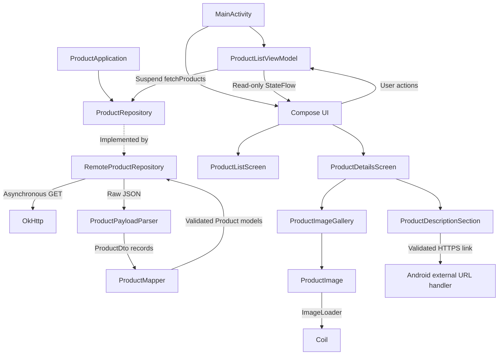

# Gymshark Product Challenge

An Android product-browsing application for the Gymshark Mobile Engineering Challenge, built with Kotlin, Jetpack Compose and MVVM.

## Implemented scope

The application implements the required catalogue journey:

- Retrieves and decodes the supplied Gymshark product JSON.
- Displays an adaptive product grid with titles, GBP prices, colours, fit and labels.
- Shows explicit loading, empty, content and error states, with retry after a failed request.
- Handles missing, invalid and failed image URLs with a local Gymshark fallback and a loading indicator.
- Opens product details using the product's stable identifier.
- Displays all supplied product photographs in a swipeable detail gallery with position indicators.
- Switches between related colour products using a documented fallback grouping rule.
- Displays the product price until a size is selected, then displays the selected variant price.
- Keeps XS, S, M, L, XL and XXL visible, appends additional supplied sizes, and disables unavailable sizes with a strike-through.
- Renders readable HTML descriptions with paragraphs, entities, Unicode and basic emphasis.
- Preserves supported absolute HTTPS links in descriptions and opens them through an external Android application.

Search, filters, authentication, checkout, persistent catalogue caching and Kotlin Multiplatform are outside the assessment brief and are not implemented. The app remains a single Android module so the required journey stays small, testable and reviewable.

## Setup

1. Open the repository in Android Studio.
2. Configure the Gradle JDK as JDK 17, matching CI.
3. Install Android SDK Platform 36 and a compatible Android Build Tools package through SDK Manager.
4. Allow Gradle to sync, then select an emulator or connected device.
5. Run the `app` configuration.

The app supports Android 6.0 and later (`minSdk 23`). It compiles against and targets SDK 36. The SDK path belongs in ignored `local.properties`. The Gradle wrapper pins the Gradle version, and dependency/plugin versions are centralised in `gradle/libs.versions.toml`.

The application ID and Kotlin namespace are `com.jovinyap.productchallenge`. The manifest declares the `INTERNET` permission because catalogue and image requests are remote.

## Architecture

`ProductApplication` creates the production repository and shared `OkHttpClient`. `MainActivity` obtains a retained `ProductListViewModel` through a ViewModel factory. The ViewModel owns presentation state and user actions; Compose renders that state and emits callbacks.



The repository invokes the parser first and passes the decoded DTOs to the mapper. The parser is responsible for JSON decoding; the mapper validates required identity, title and non-negative price fields, then creates presentation-ready `Product` models while preserving optional data where possible.

`ProductListRoute` collects the ViewModel's read-only `StateFlow` with `collectAsStateWithLifecycle`. List and detail composables do not know how data is downloaded. Catalogue loading, retry, product navigation, colour selection and size selection remain in the ViewModel. Manual constructor injection keeps the network and repository boundaries replaceable in tests without introducing an additional dependency-injection framework.

## Data and networking decisions

`RemoteProductRepository` accepts an injected `okhttp3.Call.Factory`. Production uses one shared `OkHttpClient`; tests provide controlled fake calls. OkHttp callbacks are bridged to a suspend function with `suspendCancellableCoroutine`, so cancellation cancels the underlying call. Response bodies are closed on success, failure and late response. JSON decoding and mapping run on an injected dispatcher, which defaults to `Dispatchers.Default`.

Network failures, unsuccessful HTTP responses and malformed JSON remain observable exceptions. A valid empty `hits` array is represented as an empty catalogue. The ViewModel converts expected retrieval/decoding failures into its explicit error state, while cancellation is allowed to propagate.

Coil loads images independently from catalogue retrieval. The image component accepts only absolute HTTPS URLs, preserves a stable layout while loading, and uses the local Gymshark logo plus explanatory text for missing, invalid or failed images. The detail gallery places featured media first, removes blank and duplicate URLs, preserves the remaining supplied order and uses `ContentScale.Fit` so the complete photograph remains visible.

## Assumptions and decisions

| Topic | Applied rule | Reason or limitation |
| --- | --- | --- |
| Currency and units | Treat API price integers as GBP minor units and format them as pounds and pence. | The payload did not define units; I spoke to Alexander I. regarding this for clarification of the pricing structure. |
| Product pricing | The grid shows product-level price. Details show that price until a size is selected, then show the selected variant price. A missing variant price is shown as unavailable. | Avoids inventing a value when a variant has no price. |
| Related colours | Group products only when normalised title, product type, gender and fit match. | The payload has no authoritative product-family identifier, so this is a conservative fallback. |
| Sizes and stock | Show XS–XXL first, retain additional payload sizes, and allow selection only when `inStock == true`. | Missing, false or unknown stock is treated as unavailable. |
| Incomplete products | Exclude records without a usable ID, title or non-negative price. Preserve nullable optional fields. | The UI cannot safely identify or price a record that fails these required checks. |
| HTML | Use Android's native HTML parser with targeted cleanup for scripts, styles and known translator wrappers. Support basic emphasis and validated absolute HTTPS links. | This is readable text rendering, not a general HTML sanitiser or WebView. |
| Rotation | `ViewModelProvider` retains the ViewModel across Activity recreation, avoiding a second catalogue request during ordinary rotation. | Selected IDs are not restored after process death because `SavedStateHandle` is not implemented. |

## Testing and verification

Run from the repository root:

```powershell
.\\gradlew.bat :app:testDebugUnitTest
.\\gradlew.bat :app:lintDebug
.\\gradlew.bat :app:assembleDebug
.\\gradlew.bat :app:connectedDebugAndroidTest
```

On macOS or Linux, use `./gradlew` instead of `.\\gradlew.bat`. The connected-device command requires an available and unlocked device or emulator. The debug APK is generated at `app/build/outputs/apk/debug/app-debug.apk`.

The test suite covers parser and mapper behaviour, price formatting, image URL and loading states, gallery mapping, HTML cleanup and links, ViewModel state transitions and cancellation, repository failures, size availability, colour grouping and Compose behaviour. Repository tests use the saved JSON fixture and controlled callbacks; they never call the live CDN.

The GitHub Actions workflow runs on pushes and pull requests targeting `main` and performs:

1. `:app:testDebugUnitTest`
2. `:app:lintDebug`
3. `:app:assembleDebug`

Connected-device tests are kept separate because they require a physical device or emulator. Passing CI provides evidence for the configured unit-test, lint and debug-build checks; it does not prove live CDN reliability, every visual detail or complete TalkBack usability.

The initial parser increment followed a recorded red-green-refactor cycle. Later changes add focused regression tests before or alongside implementation, with requirement references in the tests where the mapping is direct. Test names and comments are evidence of exercised behaviour, not a claim that every requirement is fully covered on every device.

## Requirements and traceability

The [requirements sheet](https://docs.google.com/spreadsheets/d/1uxhjZrefBlAgYI7_xCwYuCZMmtnH3zr-vEn0OgE3W0A/edit?gid=0#gid=0) is the acceptance and traceability record. It contains the 37 numbered rows currently used for the submission:

- `GS-MOB-001`–`GS-MOB-029` cover the supplied brief and core engineering expectations.
- `GS-MOB-030`–`GS-MOB-034` describe the related-colour, size and variant-price enhancements.
- `GS-MOB-035`–`GS-MOB-037` describe clickable HTTPS description links, the multi-photo gallery and the Gymshark-inspired responsive card design.

Rows 030–033 are derived definitions supplied for the current master sheet. The enhancement and design rows are clearly labelled so optional work is not presented as an original mandatory brief requirement.

The [design and decision working notes](https://docs.google.com/document/d/1SUF0EtdFnyNWRxBMBRo9MiI3itb_VbYZjgUYwwmgmNo/edit?tab=t.5gnfbuiie62o) contain the fuller journey from brief to requirements, design, architecture, assumptions, trade-offs and future ideas. They are supplementary to this README and may continue to receive editorial updates after submission.

## Known limitations and future work

- No persistent offline catalogue cache is implemented.
- Selected product and variant IDs are not restored after process death.
- Colour grouping is inferred from metadata and cannot guarantee an authoritative family relationship.
- Product photographs are supported; video links in descriptions open externally rather than being embedded.
- Search, filtering, authentication, checkout, wishlist, reviews and recommendations are outside the submitted scope.

## AI usage

I used my experience of Android and software development to lay out a structured plan going from brief to requirements then to testing and code implementation. ChatGPT and Codex were used as development assistants for planning increments, analysing the supplied payload, exploring Kotlin and Jetpack Compose approaches, drafting tests and documentation, and investigating failures.

AI helped accelerate exploration coverage given the time constraint, but I remained responsible for the engineering decisions, verification and conducting user testing. I compared suggestions with the brief, the actual payload, device behaviour and test results.

An initial data review helped identify incomplete records and malformed values, but it did not identify every important product behaviour. I manually discovered that descriptions contained HTTPS and YouTube links, some products had multiple photographs, and related colours were represented as separate records. I added requirements and implemented bounded solutions to make product discovery and product family grouping more intuitive to reduce the effort required to find colour variations.

I deliberately kept filters, checkout, authentication, persistent caching and Kotlin Multiplatform outside the submission because they were not required by the brief.

AI output was treated as a proposal requiring human review and verification through unit tests, Robolectric Compose tests, instrumented checks, lint, debug builds and manual device testing.

## Next Stage of Development

Time permitting, potential future work includes search, filtering, analytics for unavailable-size demand, offline caching, richer model metadata and more advanced product visualisation. These were excluded from the assessment to protect the core user journey and verification quality.
